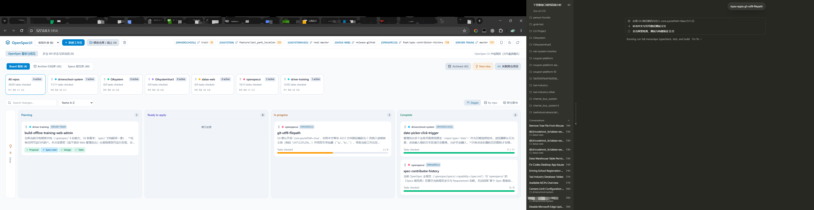
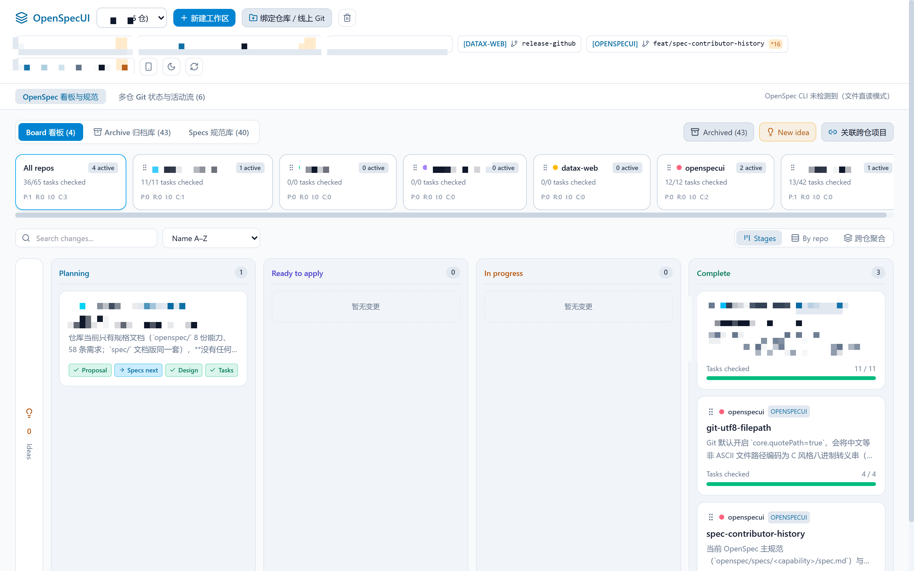
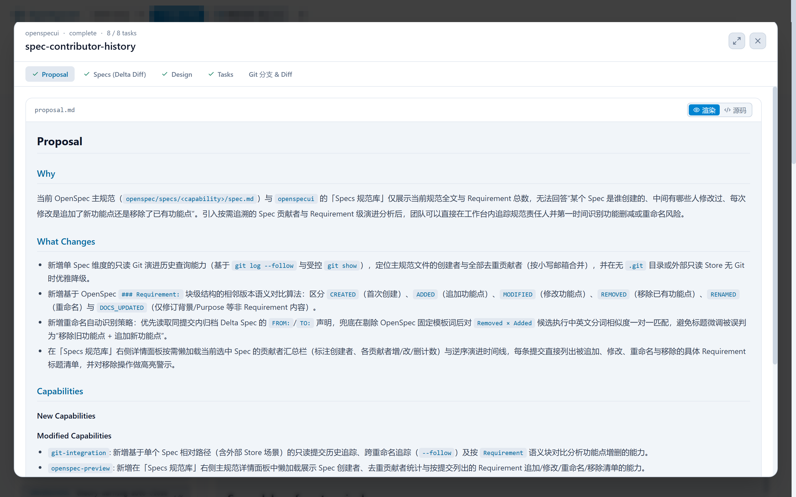
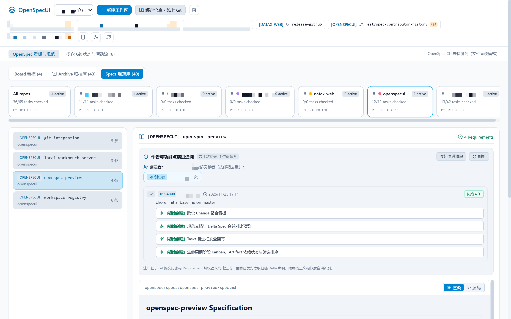
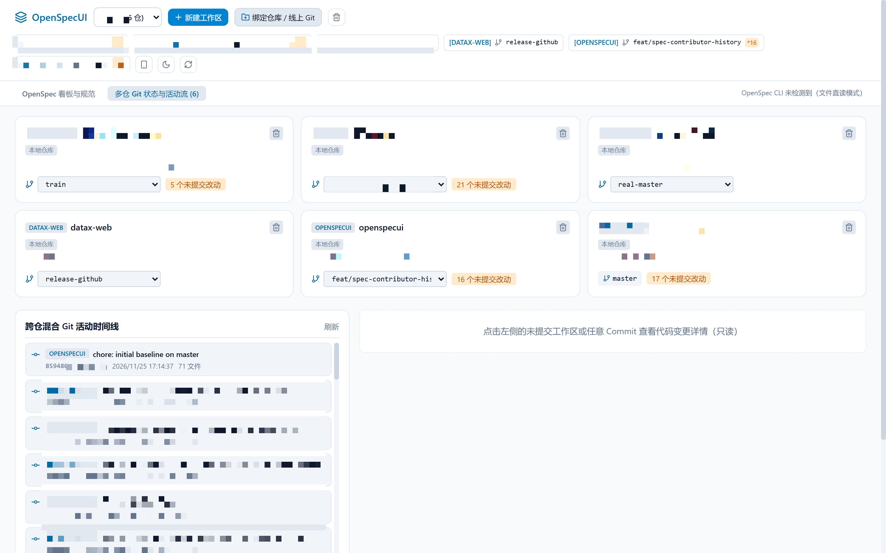
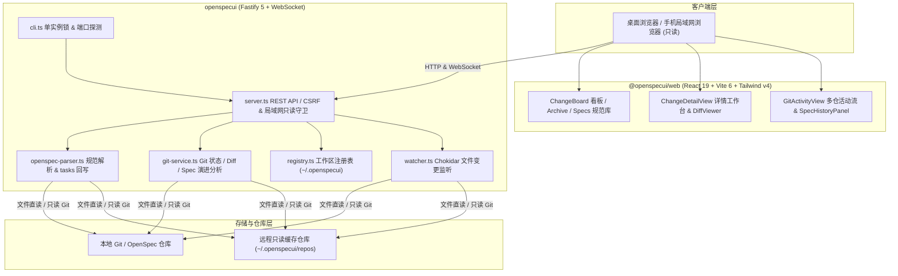

# OpenSpecUI

<p align="center">
  
  
  
  
  
</p>

> **面向 OpenSpec 的本地多工作区可视化工作台与只读 Git 伴侣**  
> *A local multi-workspace visual workbench and read-only Git companion for OpenSpec.*

---

## 📖 项目简介 / Introduction

**OpenSpecUI** 是专为 [OpenSpec](https://github.com/Fission-AI/OpenSpec) 规范驱动开发工作流打造的本地可视化工作台。

在多仓库协同开发场景中（如前后端分离、独立 Spec Store、多端并行迭代），单纯依靠命令行或翻阅分散的 Markdown 文件往往面临**跨仓变更进度不直观、Proposal/Specs/Design/Tasks 关联割裂、主规范演进历史难追溯、多仓 Git 状态切换繁琐**等痛点。

本项目采用 `Fastify + React + TypeScript` Monorepo 架构，在不侵入业务仓库的前提下提供：
1. **多工作区与跨仓 Change 聚合看板**（多阶段 Kanban、By-Repo 泳道、跨仓项目/Change 手动关联）；
2. **Change 详情工作台与 Tasks 安全回写**（四大产物集中预览、Delta vs Main Diff 对比、复选框实时回写）；
3. **Specs 规范库与 Requirement 级演进追溯**（主规范浏览、归档库检索、Git 创建者/贡献者及功能点变更追踪）；
4. **多仓 Git 状态伴侣与活动时间线**（多仓分支/脏状态总览、只读 Diff 查看、远程只读缓存同步）；
5. **本地单实例与局域网只读预览**（端口自动探测与实例复用、WebSocket 实时监听刷新、手机端只读访问）。

---

## 🌟 核心特性 / Key Features

### 1. 📋 多工作区与跨仓 Change 聚合看板 (Multi-Workspace & Kanban Board)
- **多视图灵活切换**：支持 **Stages**（Planning / Ready to apply / In progress / Complete 四阶段看板）、**By repo**（按仓库泳道分组）以及 **跨仓聚合** 三种布局模式。
- **跨仓协同关联**：支持将前后端不同命名的 Change 手动关联为逻辑需求组，支持创建多仓协同项目组及 `openspec-ui.json` 工作集导入。
- **Ideas 与高效检索**：内置工作区 Ideas 灵感记录栏，支持按仓库过滤、关键词搜索、排序及自定义拖拽重排。

<p align="center">
  
</p>

<p align="center">
  
</p>

### 2. 📝 Change 详情工作台与 Tasks 安全回写 (Change Workbench & Task Sync)
- **五大视图一站式预览**：集中展示 `Proposal`、`Specs (Delta Diff)`、`Design`、`Tasks` 与 `Git 分支 & Diff`，支持 Markdown 内部相对路径跨 Tab 跳转与全屏阅读。
- **Delta vs Main 规范对比**：在 `Specs` 标签页支持切换「规范文档渲染」与「Delta vs Main 对比」，清晰核对新增、修改与移除的规范条目。
- **Tasks 安全回写**：支持在界面直接勾选/取消 `tasks.md` 任务项并安全写回本地文件；针对远程只读缓存仓或局域网只读模式自动锁定写入。

<p align="center">
  
</p>

### 3. 📚 Specs 规范库与作者/功能点演进追溯 (Specs Library & Evolution History)
- **集中浏览与归档检索**：统一展示工作区内所有仓库的主规范（`openspec/specs/*/spec.md`）与历史归档变更（`Archive`）。
- **作者与贡献者归因**：按需懒加载单条主规范的 Git 历史，自动识别创建者并按邮箱去重统计每位贡献者的提交次数与变更量。
- **Requirement 语义级演进时间线**：解析每次 Git 提交中 Requirement 的新增（`+`）、修改（`~`）、重命名（`>`）与移除（`-`）清单，规范演化脉络一目了然。

<p align="center">
  
</p>

### 4. 🌿 多仓 Git 状态伴侣与只读 Diff (Read-Only Git Companion)
- **多仓状态卡片**：一屏掌握所有绑定仓库的当前分支、未提交改动数、远程只读缓存同步状态（支持手动或定时 `git fetch`）及本地分支切换。
- **跨仓混合活动时间线**：按时间倒序聚合所有仓库的提交记录，点击任意未提交工作区或历史 Commit 即可查看只读代码 Diff。
- **Change 与分支绑定（Pin）**：支持将特定 Change 与仓库分支或 Commit SHA 手动绑定，避免多分支并行开发时定位混淆。

<p align="center">
  
</p>

### 5. ⚡ 本地单实例、实时监听与局域网只读访问
- **单实例复用机制**：重复执行启动命令会自动探测 `~/.openspecui/server.lock.json`，复用已运行实例并切换工作区上下文，避免端口冲突。
- **Chokidar + WebSocket 实时刷新**：监听本地 `openspec/` 与 `.git/` 变更，编辑器或 AI 工具修改文档后工作台自动同步更新。
- **局域网/手机只读预览**：通过 `--host 0.0.0.0` 启动时自动切换为局域网只读模式（禁用写操作与本机目录控制），并在顶部提供局域网访问地址引导与深/浅色主题切换。

---

## 🏗️ 架构拓扑 / Architecture



---

## 📂 项目结构 / Project Structure

```text
openspecui/
├── packages/
│   ├── shared/                     # 共享领域模型、TypeScript 类型与 Zod 校验契约
│   │   └── src/
│   │       ├── types.ts            # Workspace、Change、SpecHistory、Git 等核心类型
│   │       └── schemas.ts          # API 请求体校验 Schema
│   ├── server/                     # Fastify 5 后端服务、CLI 入口与单元测试
│   │   ├── scripts/
│   │   │   └── copy-web.mjs        # 构建时将前端静态产物同步至 server/dist/public
│   │   ├── src/
│   │   │   ├── cli.ts              # 单实例检测、端口探测与浏览器拉起入口
│   │   │   ├── server.ts           # HTTP API、WebSocket 推送与只读安全守卫
│   │   │   ├── openspec-parser.ts  # OpenSpec 变更聚合、Delta 对比与 tasks.md 回写
│   │   │   ├── git-service.ts      # 多仓 Git 状态、Diff 及 Spec Requirement 演进分析
│   │   │   ├── remote-repo.ts      # 远程仓库受控只读克隆与定时 fetch 管理
│   │   │   ├── registry.ts         # 多工作区注册表与目录自动发现
│   │   │   ├── watcher.ts          # Chokidar 文件监听与 WS 增量广播
│   │   │   └── security.ts         # 本地路径校验与请求安全检查
│   │   └── test/                   # Vitest 集成与单元测试
│   └── web/                        # React 19 + Tailwind CSS v4 前端工作台
│       └── src/
│           ├── App.tsx             # 顶层工作台、工作区切换与主题管理
│           └── components/         # ChangeBoard、ChangeDetailView、SpecHistoryPanel 等组件
├── docs/
│   └── images/                     # README 界面预览截图
├── openspec/                       # 本项目自身的 OpenSpec 主规范与变更目录
├── start-openspecui.bat            # Windows 一键安装构建并启动脚本
├── package.json                    # Monorepo 根配置与构建/开发脚本
└── tsconfig.base.json              # TypeScript 共享编译配置
```

---

## 🚀 快速上手 / Quick Start

### 1. 环境准备
- **Node.js**: `>= 20.0.0`
- **Git**: 用于多仓状态查询、Diff 查看及 Spec 演进历史追溯

### 2. 安装依赖与构建
```bash
git clone <your-repo-url>
cd openspecui
npm install
npm run build
```

### 3. 启动工作台

#### 方式一：命令行启动
```bash
# 默认在 127.0.0.1:3456 启动并自动打开浏览器，同时注册当前目录
npm run start

# 指定目标项目目录与端口
node packages/server/dist/cli.js D:\path\to\your\project --port 3456

# 开启局域网只读访问（适合手机或同局域网设备查看）
node packages/server/dist/cli.js --host 0.0.0.0 --no-open
```

#### 方式二：Windows 一键启动
直接双击或运行根目录下的 [`start-openspecui.bat`](start-openspecui.bat)，脚本会自动检测 Node.js、安装缺失依赖、构建产物并启动本地服务。

### 4. CLI 启动参数说明

| 参数 | 默认值 | 说明 |
| :--- | :--- | :--- |
| `[targetDir]` | 当前工作目录 | 启动时自动扫描并激活的目标项目或工作集目录 |
| `--port <number>` | `3456` | 起始监听端口（若被占用会自动向上探测可用端口） |
| `--host <addr>` | `127.0.0.1` | 绑定地址；设为 `0.0.0.0` 时自动进入局域网只读预览模式 |
| `--no-open` | `false` | 启动后不自动拉起默认浏览器 |
| `--dev` | `false` | 开发模式，自动打开 Vite 前端地址 `http://127.0.0.1:5173` |

### 5. 本地开发与测试
```bash
# 终端 1：启动后端热更新服务
npm run dev:server

# 终端 2：启动前端 Vite 开发服务器
npm run dev:web

# 类型检查与单元测试
npm run typecheck
npm run test
```

---

## 🔒 安全与只读设计 / Security Notice

1. **Git 只读伴侣原则**：所有远程关联仓库统一克隆至 `~/.openspecui/repos/` 受控目录并标记为只读；Git 视图仅提供状态查看、Diff 检视与受控分支切换，不提供 Commit / Push 等破坏性操作。
2. **局域网只读隔离**：当使用 `--host 0.0.0.0` 暴露局域网访问时，服务端强制开启 `readOnlyMode`，拦截 `tasks.md` 回写、工作区增删、目录浏览与分支切换等写接口。
3. **本地目录边界校验**：`tasks.md` 写回与路径读取均经过路径规范化校验与 CSRF Token 验证，防止目录穿越与未授权跨源修改。

---

## 🤝 鸣谢 / Acknowledgements

- 感谢 [Fission-AI/OpenSpec](https://github.com/Fission-AI/OpenSpec) 提供的规范驱动开发工作流标准。
- 感谢 [LINUX DO](https://linux.do/) 社区对本项目开源交流与推广的支持。

